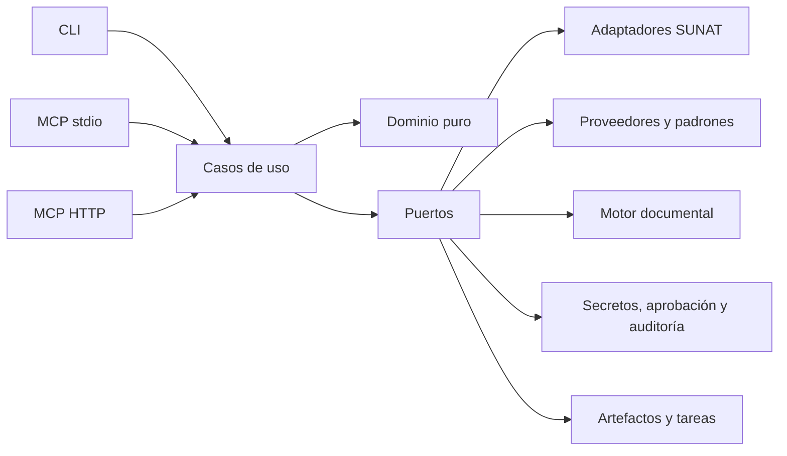

# Agent Nyro SUNAT

Agente open source para consultar, preparar y, en etapas posteriores, ejecutar flujos de SUNAT de manera segura y auditable.

> Estado: fundaciones de implementación. **Todavía no es apto para producción ni emite comprobantes.**

El proyecto será local-first: la primera versión útil funcionará por CLI y MCP `stdio`, sin enviar credenciales al modelo. La exposición HTTP remota y cualquier operación con efecto fiscal llegarán después de validar el núcleo, la autenticación y los controles de aprobación humana.

## Alcance inicial

La primera entrega (`v0.1`) será de solo lectura:

- consultar RUC mediante proveedores intercambiables y padrón local;
- validar comprobantes mediante el servicio oficial disponible;
- consultar padrones y tipo de cambio;
- exponer los mismos casos de uso por CLI y MCP `stdio`;
- devolver procedencia, fecha de consulta y carácter oficial/no oficial de cada dato.

Implementado hasta ahora:

- core puro con tipos, errores, puertos y casos de uso read-only;
- contratos públicos `camelCase` con JSON Schema 2020-12 y versión explícita para CLI/MCP;
- adapters y fixtures sintéticos para pruebas sin red;
- autenticación OAuth y adaptador de consulta integrada CPE según el contrato oficial;
- transporte HTTP con allowlist, timeout, límite de respuesta y redirects bloqueados;
- perfiles locales sin secretos y CLI para validación CPE;
- consulta RUC con API Perú, Decolecta y fallback al Padrón Reducido oficial importado en SQLite;
- actualización atómica y acotada del padrón, con hash, versión, procedencia y advertencia de antigüedad;
- perfiles restringidos a `cpe-validation-read-only` y diagnóstico OAuth que descarta el token sin consultar comprobantes.

La CLI ya conectó el flujo completo contra una cuenta y un comprobante autorizados. La evidencia compartida se limita a estado normalizado, procedencia y `requestId`; no se conservan RUC, serie/número, respuestas crudas ni secretos en el repositorio. Repetir esa validación requiere autorización propia y credenciales guardadas fuera de Git.

La preparación de UBL, emisión CPE, GRE y SIRE se incorporará por fases, detrás de validaciones, ambientes beta y aprobación explícita. La consulta de DNI/RENIEC, el envío del Formulario 621 y la automatización por navegador no pertenecen a `v1`.

## Arquitectura

La línea base propuesta es un monorepo TypeScript estricto con arquitectura hexagonal:



El dominio no conocerá transporte, credenciales, archivos ni SDKs externos. Esto permite sustituir proveedores, adaptar cambios de SUNAT y evaluar motores UBL existentes sin acoplar el producto a uno de ellos.

Documentos principales:

- [Arquitectura objetivo](docs/architecture.md)
- [Roadmap por fases](docs/roadmap.md)
- [Modelo de seguridad](docs/security.md)
- [Protocolo de pruebas reales de solo lectura](docs/live-readonly-testing.md)
- [Investigación y fuentes](docs/research.md)
- [Decisiones de arquitectura](docs/adr/README.md)
- [Cómo contribuir](CONTRIBUTING.md)
- [Política de seguridad](SECURITY.md)

## Principios no negociables

- Nunca se pasan claves SOL, certificados, tokens o contraseñas como argumentos de CLI ni parámetros de herramientas MCP.
- Nunca se usan datos reales de clientes, personas o contribuyentes en fixtures, issues o repositorios públicos.
- Los importes fiscales usan representación decimal exacta; no se usa `number` como tipo monetario de dominio.
- Toda operación fiscal productiva requiere aprobación humana específica, temporal y de un solo uso.
- Ante un resultado de envío ambiguo, primero se reconcilia el estado; no se reintenta a ciegas.
- Los adaptadores solo pueden contactar endpoints expresamente permitidos.
- Las pruebas con un RUC real usan un CPE conocido y autorizado; nunca datos aleatorios de terceros.
- Cada resultado identifica su fuente, momento de obtención y si proviene de una fuente oficial.

## Relación con SUNAT

Este proyecto no está afiliado ni respaldado por SUNAT. Es responsabilidad de cada usuario verificar la normativa, los certificados, las credenciales y los efectos tributarios de sus operaciones. La documentación oficial vigente de SUNAT prevalece sobre este repositorio.

## Privacidad, riesgo tributario y garantías

Quien despliega este software y procesa datos personales o tributarios es responsable de evaluar y
cumplir la Ley N.° 29733, su reglamento y las demás obligaciones aplicables. El carácter open source
del código no convierte al proyecto en encargado del tratamiento ni transfiere esa responsabilidad.

Un defecto en software tributario puede causar rechazos, duplicidades, multas u otros efectos reales.
La versión actual es exclusivamente de consulta y no contiene rutas de emisión. Cuando existan
operaciones de escritura, beta y producción serán perfiles separados, beta será el destino inicial y
producción permanecerá deshabilitada por defecto hasta superar sus gates de aprobación y seguridad.

El software se entrega bajo licencia MIT y **sin garantía**, incluida cualquier garantía implícita de
idoneidad tributaria o disponibilidad de los servicios externos. Cada usuario debe validar reglas,
ambiente, credenciales y resultados con profesionales y documentación oficial vigente.

## Desarrollo local

Requisitos: Node.js 24 LTS y pnpm 11. Desde la raíz:

```bash
pnpm install
pnpm check
```

`pnpm check` comprueba formato, lint, tipos y pruebas.

Para probar proveedores RUC desde `.env.local`, define solo las credenciales que usarás:

```dotenv
APIPERU_TOKEN=
DECOLECTA_TOKEN=
SUNAT_CLIENT_ID=
SUNAT_CLIENT_SECRET=
```

Luego compila, actualiza el padrón y consulta con fallback:

```bash
pnpm build
node apps/cli/dist/main.js padron-ruc-actualizar
node --env-file=.env.local apps/cli/dist/main.js consultar-ruc \
  --ruc 20000000000 \
  --provider auto \
  --credenciales environment \
  --json
```

El RUC del ejemplo es sintético. Para aislar resultados también puedes usar `--provider apiperu`,
`--provider decolecta` o `--provider local`. `auto` omite proveedores sin token configurado, pero se
detiene si un proveedor configurado rechaza la autenticación. En uso normal se recomienda Secret
Service; `.env.local` es una opción soportada para desarrollo local, debe permanecer ignorado por Git
y tener permisos restrictivos.

Antes de contribuir, instala también el hook local de secretos:

```bash
python -m pip install pre-commit
pre-commit install
pre-commit run --all-files
```

CI descarga Gitleaks 8.30.1, verifica su checksum, comprueba que detecta un secreto canary sintético y
escanea el historial completo. Ningún hallazgo puede integrarse.

## Licencia

[MIT](LICENSE) © 2026 NyroCode.
