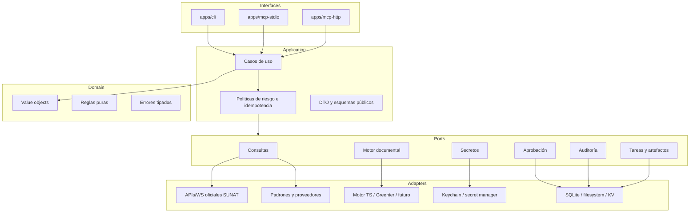
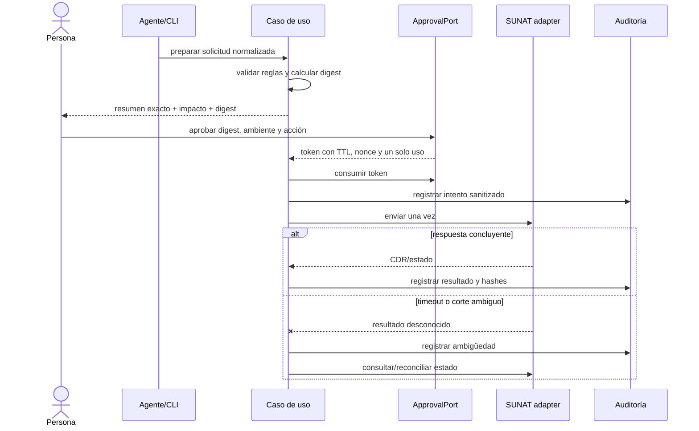

# Arquitectura objetivo

Estado: **línea base aceptada y en implementación**. Los detalles de motores fiscales y despliegue remoto siguen sujetos a sus ADR y spikes específicos.

## 1. Decisión resumida

Agent Nyro SUNAT será un monorepo TypeScript estricto, ESM, ejecutado inicialmente en Node.js, con arquitectura hexagonal y tres interfaces de entrada que comparten casos de uso:

1. CLI para personas y automatizaciones locales;
2. MCP `stdio` como transporte local predeterminado;
3. MCP Streamable HTTP para despliegues remotos, habilitado después y de solo lectura al inicio.

No se construirá el producto alrededor de un SDK SUNAT concreto. El motor de UBL/firma/envío será un puerto reemplazable. Esto permite evaluar colaboración con proyectos existentes, un adaptador a Greenter u otra implementación sin contaminar el dominio ni bloquear la evolución del agente.

## 2. Motivos

- TypeScript ofrece un camino directo al SDK oficial MCP, ejecución local y adaptadores web para Cloudflare/Hono.
- El valor diferencial de Nyro está en orquestación segura, aprobación, trazabilidad y experiencia de agente, no en volver a escribir desde cero cada regla XML.
- SUNAT mezcla REST, SOAP, archivos, tickets asíncronos y fuentes sin API oficial uniforme; los adaptadores aíslan esa variabilidad.
- Un proyecto open source necesita permitir proveedores alternativos y despliegues locales sin obligar al usuario a confiar secretos a un servicio Nyro.
- La especificación MCP vigente favorece solicitudes sin estado y handles explícitos para trabajos duraderos.

## 3. Principios

### Dominio puro

El dominio conoce RUC, comprobantes, periodos, importes, estados y errores tributarios. No conoce HTTP, SOAP, XML libraries, variables de entorno, MCP ni almacenamiento.

### Capacidades antes que proveedores

Los casos de uso dependen de interfaces como `TaxpayerLookupPort` o `DocumentEnginePort`. “SUNAT”, “padrón local” y los proveedores privados son implementaciones configurables.

### Seguro por defecto

El modo predeterminado es local, solo lectura y sin telemetría de contenido. Producción se habilita explícitamente y nunca hereda autorización de beta.

### Estado explícito

Una tarea asíncrona devuelve un handle persistible. Ninguna operación depende de una sesión MCP oculta. Cada solicitud lleva identidad, versión de protocolo y contexto de autorización verificable.

### Evidencia y procedencia

Una respuesta de consulta incluye `source`, `fetched_at`, `is_official` y, cuando aplique, vigencia del dato. Una mutación conserva solicitud normalizada, hash, aprobación, resultado y artefactos sanitizados.

## 4. Mapa de componentes



## 5. Estructura prevista

La fase 0 puede ajustar nombres, pero debe preservar estos límites:

```text
apps/
  cli/                  comandos y presentación humana/JSON
  mcp-stdio/            servidor MCP local
  mcp-http/             servidor MCP remoto
packages/
  core/                 dominio, casos de uso, puertos, errores
  sunat/                adaptadores oficiales REST/SOAP/SIRE/GRE
  providers/            padrón local y proveedores alternativos
  document-engines/     adaptadores UBL, firma y CDR
  security/             secretos, aprobación, auditoría, allowlists
  mcp/                  contratos y traducción MCP compartida
  testing/              builders, fixtures sintéticos y contract tests
docs/
  adr/
  architecture.md
  roadmap.md
  security.md
  research.md
```

Herramientas previstas: Node.js 24 LTS, pnpm workspaces, TypeScript estricto, una librería decimal mantenida, validación de esquemas en bordes y un runner de pruebas compatible con ESM. Las versiones se fijarán en lockfile y se automatizarán actualizaciones controladas.

## 6. Modelo de dominio

### Tipos esenciales

- `Ruc`: cadena validada de 11 dígitos con validación de formato, sin asumir que formato equivale a existencia.
- `Money`: decimal exacto serializado como cadena canónica y acompañado de moneda.
- `Rate`: decimal exacto con escala explícita.
- `LocalDate`: `YYYY-MM-DD` sin conversión silenciosa de zona horaria.
- `Period`: año/mes validado.
- `DocumentId`: RUC emisor + tipo + serie + correlativo, normalizado.
- `Environment`: `beta` o `production`; nunca booleano.
- `Provenance`: fuente, oficialidad, instante de consulta, versión/fecha del dataset.
- `ArtifactRef`: identificador y hash; no una ruta arbitraria proporcionada por el modelo.
- `TaskHandle`: identificador opaco de una operación asíncrona persistida.

Los DTO públicos solo aceptan JSON seguro y acotado. Certificados, contraseñas y tokens no aparecen en sus esquemas.

### Errores

El núcleo distinguirá al menos:

- `ValidationError`: entrada inválida antes de contactar servicios;
- `AuthenticationError`: secreto ausente/rechazado, siempre redactado;
- `AuthorizationError`: identidad sin permiso o aprobación inválida;
- `RateLimitError`: límite remoto con tiempo de reintento si existe;
- `ProviderUnavailableError`: falla transitoria conocida;
- `BusinessRuleRejection`: SUNAT procesó y rechazó con código/descripcion;
- `AmbiguousSubmissionError`: no se sabe si una escritura fue aplicada;
- `ContractDriftError`: respuesta externa no coincide con el contrato esperado.

Los mensajes públicos serán accionables, pero nunca incluirán secretos ni cuerpos completos sin sanitizar.

## 7. Puertos principales

| Puerto | Responsabilidad | Adaptadores previstos |
|---|---|---|
| `VoucherValidationPort` | Validar existencia/estado de CPE | Servicio oficial integrado |
| `TaxpayerLookupPort` | Consultar RUC con procedencia | API oficial disponible, proveedor privado, padrón local |
| `RegistryPort` | Consultar padrones por versión | Archivos oficiales descargados y verificados |
| `ExchangeRatePort` | Consultar tipo de cambio | Fuente oficial/configurable |
| `DocumentEnginePort` | Construir, validar, firmar, empaquetar y leer CDR | Motor TS evaluado, Greenter bridge u otro |
| `FiscalSubmissionPort` | Enviar y consultar CPE/GRE/SIRE | SOAP/REST oficial por ambiente |
| `SecretPort` | Resolver referencias opacas a secretos | Keychain, vault, secret manager |
| `ApprovalPort` | Emitir/verificar autorización de una sola operación | Local interactivo, servicio remoto |
| `AuditPort` | Registrar eventos inmutables y sanitizados | JSONL firmado, DB append-only |
| `TaskPort` | Crear/consultar/cancelar tareas | SQLite local, almacenamiento remoto |
| `ArtifactPort` | Guardar XML/ZIP/CDR y verificar hash | Filesystem seguro, object storage |

Cada adaptador externo tendrá contract tests comunes. Cambiar de proveedor no debe alterar el esquema público salvo diferencias expresadas en `Provenance` o capacidades.

## 8. Interfaces públicas

### Primera versión MCP/CLI

| Caso de uso | MCP | Riesgo | Resultado mínimo |
|---|---|---:|---|
| Consultar contribuyente | `consultar_ruc` | Solo lectura | estado, condición, procedencia |
| Validar comprobante | `validar_comprobante` | Solo lectura | estado y respuesta normalizada |
| Consultar padrón | `consultar_padron` | Solo lectura | pertenencia, versión y procedencia |
| Consultar tipo de cambio | `tipo_cambio` | Solo lectura | compra/venta, fecha y fuente |

Los nombres se mantienen en español y `snake_case`. Las salidas tendrán esquemas versionados y una envoltura consistente: `data`, `provenance`, `warnings`, `request_id`.

### Capacidades posteriores

- `preparar_comprobante`: genera borrador/artefactos, sin efecto fiscal;
- `probar_comprobante_beta`: firma y envía únicamente a beta;
- `emitir_comprobante`: escritura fiscal productiva con aprobación;
- `consultar_estado_envio`: reconcilia un envío conocido;
- `obtener_artefactos`: entrega referencias autorizadas, no rutas arbitrarias;
- GRE y SIRE: devuelven `TaskHandle` cuando la operación oficial sea asíncrona.

Una herramienta no recibe `sol_password`, certificados ni tokens. Recibe, como máximo, una referencia opaca a un perfil configurado fuera de la conversación.

## 9. Flujo de una escritura productiva



El token de aprobación queda ligado a identidad, operación, digest del payload, RUC/perfil, ambiente, expiración y nonce. No autoriza una segunda operación ni un payload modificado.

## 10. MCP y compatibilidad

- MCP `stdio` será el transporte recomendado para uso local.
- El servidor remoto usará Streamable HTTP y será stateless a nivel de protocolo.
- Las tareas duraderas usarán la extensión oficial de Tasks y almacenamiento explícito.
- Se fijará la versión del SDK y del protocolo; la compatibilidad con clientes 2025 se evaluará en una matriz y tendrá fecha de retiro.
- Autenticación HTTP, identidad de usuario y autorización son responsabilidades separadas de las credenciales SUNAT.
- El despliegue remoto inicial será de una sola organización/tenant. Multi-tenant queda fuera hasta completar un threat model específico.

## 11. Datos y persistencia

### Local

- SQLite para tareas, idempotencia y metadatos de auditoría;
- filesystem con permisos restrictivos para artefactos;
- keychain del sistema o vault local para secretos;
- rutas determinadas por configuración confiable, nunca por input directo del modelo.

### Remoto

- base de datos/KV para tareas e idempotencia;
- object storage cifrado para artefactos;
- secret manager administrado;
- logs estructurados sin payloads fiscales completos.

Los artefactos tendrán hash SHA-256, tipo, tamaño, propietario, ambiente, retención y relación con el evento de auditoría. La política de retención será configurable y documentada antes de producción.

## 12. Estrategia de motor documental

No se elegirá por popularidad solamente. La fase 0 ejecutará el mismo conjunto de contract tests sobre las alternativas:

1. colaborar/adaptar el proyecto TypeScript existente;
2. adaptar Greenter mediante un proceso/servicio local opcional;
3. implementar internamente solo la parte que no pueda reutilizarse con seguridad.

La evaluación incluye licencia, actividad, precisión decimal, UBL/XSD, firma XML, algoritmos admitidos, ZIP, CDR, errores, beta real, compatibilidad de runtime, distribución pública y costo de mantenimiento. Ningún motor toma control de secretos o aprobación: recibe material resuelto por un borde seguro y solo durante la operación necesaria.

## 13. Pruebas

- unitarias para value objects y reglas de redondeo;
- property-based para invariantes monetarias y descomposición de totales;
- fixtures dorados sintéticos para XML, ZIP y CDR;
- validación XSD y reglas SUNAT versionadas;
- contract tests reutilizables para cada puerto/adaptador;
- fuzzing de parsers XML/ZIP y límites de tamaño/profundidad;
- pruebas de compatibilidad MCP por versión;
- integración beta protegida y programada;
- smoke tests productivos exclusivamente no destructivos, cuando existan;
- pruebas de regresión para cada rechazo/código corregido.

Los PR de forks no reciben secretos. Las pruebas beta se ejecutan después de revisión, con entorno protegido y evidencia sanitizada.

## 14. Observabilidad

Cada operación propaga `request_id`, `correlation_id`, versión del adaptador y ambiente. Métricas y logs evitan RUC, nombres, direcciones, XML, tokens y certificados. Los campos sensibles se redactan por allowlist, no por una lista incompleta de patrones prohibidos.

Una escritura produce una cadena auditable: quién solicitó, qué digest aprobó, quién aprobó, qué adaptador/versión se usó, cuándo ocurrió y qué hash tienen los artefactos/resultados.

## 15. Decisiones pendientes de fase 0

- confirmar con mantenedores la posibilidad de colaborar con el motor TypeScript existente;
- seleccionar librería decimal, validador XML y estrategia de firma tras pruebas;
- fijar versión estable del SDK MCP y ventana de compatibilidad heredada;
- confirmar licencias/redistribución de XSD, catálogos y padrones oficiales;
- decidir formato del almacén de auditoría local y su mecanismo antimanipulación;
- verificar qué operaciones oficiales ofrecen idempotencia o consulta suficiente para reconciliar;
- resolver NYR-234: mantener DNI fuera de `v1` salvo revisión legal explícita.

El roadmap convierte estas decisiones en gates verificables, no en supuestos silenciosos.
