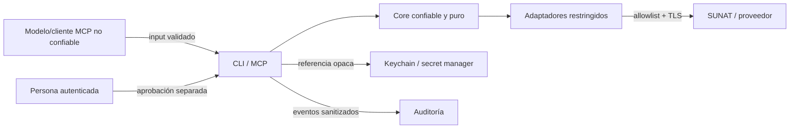

# Modelo de seguridad

Estado: baseline para fase 0. Debe actualizarse cada vez que se añade una capacidad, un tipo de secreto o un modo de despliegue.

## 1. Objetivos

- impedir filtración de claves SOL, certificados, tokens y datos tributarios;
- evitar acciones fiscales accidentales, manipuladas o repetidas;
- conservar evidencia suficiente sin convertir logs en una copia de datos sensibles;
- aislar identidad del usuario, autorización del agente y credenciales de SUNAT;
- resistir inputs hostiles provenientes del modelo, documentos, proveedores y red.

## 2. Activos

1. credenciales SOL y OAuth;
2. certificados de firma y contraseñas;
3. XML, ZIP, CDR y archivos SIRE;
4. RUC, nombres, direcciones y datos personales contenidos en documentos;
5. tokens de aprobación e identidad del aprobador;
6. historial de auditoría y hashes;
7. configuración de endpoints, perfiles y proveedores;
8. integridad del paquete open source y sus dependencias.

## 3. Fronteras de confianza

Se considera no confiable todo texto generado por un modelo, respuesta externa, XML/ZIP recibido, archivo importado y ruta indicada por el usuario hasta validarlo.

## 4. Clasificación de acciones

| Clase | Ejemplos | Política |
|---|---|---|
| `READ_ONLY` | consultar RUC/CPE/padrón/tipo de cambio | autenticación según despliegue; sin aprobación fiscal |
| `PREPARE` | generar/validar XML, calcular totales | confirmación si escribe artefactos; sin contacto productivo |
| `BETA_WRITE` | enviar comprobante a beta | perfil beta explícito y auditoría |
| `FISCAL_WRITE` | emitir CPE/GRE, aceptar/reemplazar SIRE | aprobación humana específica y de un solo uso |
| `ADMIN` | configurar perfiles, rotar secretos, cambiar allowlist | interfaz separada, privilegio elevado y auditoría |

Una acción no puede rebajar su clase mediante configuración del modelo o un parámetro de la misma herramienta.

## 5. Amenazas y controles

| Amenaza | Escenario | Controles obligatorios |
|---|---|---|
| Exfiltración de secretos | prompt/tool pide clave o log imprime header | referencias opacas, vault, schemas sin campos secretos, redacción por allowlist |
| Prompt injection | documento externo ordena emitir/cambiar destino | separar datos de instrucciones, validación de schema, políticas fuera del modelo |
| SSRF | URL/proveedor controlado por input | endpoints por configuración confiable y allowlist exacta, sin redirects libres |
| Emisión duplicada | timeout provoca retry | clave de idempotencia, estado `UNKNOWN`, consulta/reconciliación antes de reenviar |
| Replay de aprobación | reutilizar token | TTL corto, nonce, digest/identidad/ambiente ligados, consumo atómico |
| Payload cambiado | aprobar una cosa y enviar otra | canonicalización y digest recalculado inmediatamente antes del envío |
| Confusión beta/producción | endpoint o credencial equivocada | tipos explícitos, perfiles separados, UI visible, build/test que bloquea producción |
| XML/ZIP malicioso | entidad externa, zip bomb, parser exhaustion | DTD/entidades deshabilitadas, límites, streaming, profundidad/tamaño máximos |
| Manipulación de auditoría | borrar/modificar evidencia | append-only, hashes encadenados o almacenamiento inmutable, acceso separado |
| Supply chain | paquete comprometido o typosquatting | lockfile, allowlist de publicación, Dependabot, CodeQL, SBOM, releases firmadas |
| Datos reales en OSS | fixture/issue contiene contribuyente real | generadores sintéticos, escaneo, checklist de PR y proceso de limpieza/rotación |
| Cruce de tenants | perfil/artefacto de otro usuario | single-tenant inicial; ownership y autorización por recurso antes de multi-tenant |

## 6. Secretos

### Permitido

- keychain del sistema para instalaciones locales;
- secret manager administrado para despliegues remotos;
- variables de entorno en CI y desarrollo local controlado; `.env.local` es admisible para el
  quickstart read-only si está ignorado por Git y usa permisos restrictivos;
- referencias como `profile_id` que el servidor resuelve después de autorizar.

### Prohibido

- flags como `--password` o `--certificate-password`;
- parámetros o respuestas MCP con secretos;
- archivos `.env`, PFX/P12/PEM o credenciales en Git;
- secretos enviados al modelo, Notion, Linear, issues o logs;
- usar credenciales de producción en PR de forks.

Los secretos deben poder rotarse sin cambiar el contrato público. El proceso en memoria minimiza copias, elimina temporales y no incluye contenido secreto en errores.

## 7. Aprobación productiva

El objeto aprobado contiene:

- versión del esquema;
- acción exacta;
- digest canónico del payload;
- ambiente `production`;
- perfil/RUC emisor;
- identidad de solicitante y aprobador;
- `issued_at`, `expires_at`, nonce;
- límites relevantes, por ejemplo conteo y total.

El `ApprovalPort` verifica firma/integridad y consume el nonce de forma atómica. Una modificación, expiración, identidad distinta o reuso cancela la acción. Aprobaciones genéricas como “emitir cualquier factura durante una hora” quedan fuera de alcance inicial.

## 8. Reintentos e idempotencia

- GET/consultas puras: reintentos limitados con backoff y jitter para errores transitorios.
- Preparación local: repetible por digest y escritura atómica.
- Escritura fiscal antes de conectar: puede reintentarse si se prueba que no se envió.
- Escritura con conexión iniciada y sin respuesta concluyente: estado `UNKNOWN`; consultar SUNAT o iniciar reconciliación manual.
- Rechazo de negocio: no reintentar sin modificar y volver a aprobar el payload.

La clave de idempotencia local incluye acción, emisor, identificador de documento, ambiente y digest. No sustituye la consulta del estado oficial.

## 9. Red

- TLS validado; no hay modo `insecure` en producción.
- Host, esquema y ruta base provienen de configuración mantenida, no de input MCP.
- Allowlist separada por beta/producción y por servicio.
- Redirects deshabilitados o limitados al mismo origen permitido.
- Timeouts de conexión/respuesta y límites de tamaño obligatorios.
- Proxies se habilitan solo mediante configuración administrativa auditable.
- Cada adaptador declara dominios requeridos para facilitar egress restrictivo.

### Perfil real de consulta CPE

La implementación actual fija cada perfil a `cpe-validation-read-only`. La política de endpoints sólo permite autenticación OAuth y Consulta Integrada CPE; las rutas de SUNAT Factura, SUNAT Beta y rutas API distintas de `validarcomprobante` se rechazan antes del transporte. `perfil-verificar` autentica, descarta el token y no consulta información tributaria.

Una prueba real requiere una aplicación API dedicada, autorización del titular del RUC y un CPE conocido de la empresa. El procedimiento completo está en [Pruebas reales de solo lectura](live-readonly-testing.md).

Secret Service es el mecanismo local recomendado, no un requisito impuesto por SUNAT. El perfil
`environment` permite que un proceso CLI/MCP local reciba `SUNAT_CLIENT_ID` y `SUNAT_CLIENT_SECRET`
desde su entorno. En ambos casos los secretos permanecen fuera de los argumentos, schemas, respuestas
y logs. Un despliegue remoto sí requiere un secret manager administrado.

## 10. Archivos y parsers

- rutas internas generadas; no aceptar `../`, enlaces simbólicos inesperados ni rutas absolutas del modelo;
- permisos mínimos y creación atómica;
- nombres originales tratados como metadatos no confiables;
- ZIP con límite de entradas, tamaño comprimido/descomprimido y ratio;
- XML sin DTD ni entidades externas;
- validación de tipo real, esquema y hash antes de procesar;
- retención y borrado configurables con evidencia.

## 11. Logs, métricas y auditoría

Logs operativos y auditoría son distintos. Los logs ayudan a operar y se pueden retener poco; la auditoría prueba decisiones y debe ser inmutable.

Campos seguros típicos: `request_id`, acción, adaptador, versión, ambiente, estado normalizado, duración, código SUNAT no sensible y hashes. Campos excluidos: headers, tokens, certificados, XML/CDR completos, nombres, direcciones y contraseñas.

Antes de guardar un cuerpo externo para depuración se crea un artefacto de acceso restringido y política explícita; no se envía a logs generales.

## 12. Controles de repositorio y release

- 2FA en organización y permisos mínimos;
- branch protection y revisión obligatoria;
- secret scanning y push protection;
- análisis estático, dependencias y licencias;
- lockfile inmutable en CI;
- publicación desde workflow protegido, no desde laptops;
- provenance/attestation, SBOM, checksums y tags firmados;
- paquetes con scope/owners explícitos para reducir typosquatting;
- ninguna release si hay secretos detectados o hallazgos críticos abiertos.

## 13. Checklist antes de producción

- [ ] Endpoint, certificado y perfil de producción separados de beta.
- [ ] Reglas/XSD/catálogos vigentes y versionados.
- [ ] Aprobación de un solo uso probada contra replay y modificación.
- [ ] Reconciliación probada ante timeout en cada punto crítico.
- [ ] Logs revisados con pruebas de canary secret.
- [ ] Rotación/revocación de secretos ensayada.
- [ ] Auditoría y hashes verificables fuera del proceso principal.
- [ ] Backup/restauración y retención de artefactos definidos.
- [ ] Runbook y responsable de incidente disponibles.
- [ ] Piloto acotado autorizado y rollback operativo.

## 14. Riesgos aceptados temporalmente

Durante `0.x`, el soporte será single-tenant, la versión MCP estará fijada y solo la última release recibirá parches. No se acepta temporalmente ninguna reducción en controles de secretos o aprobación productiva.
